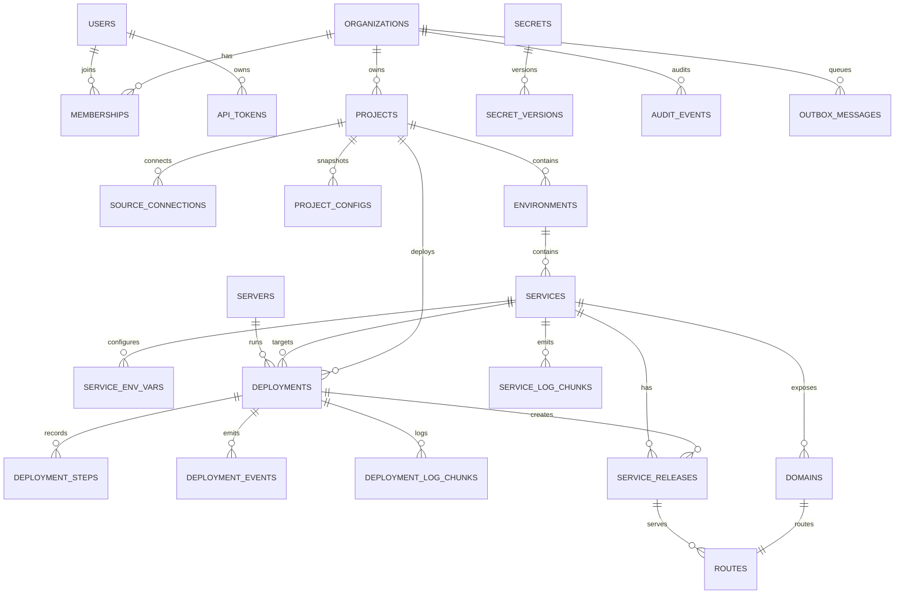

# Marsa — Data Model

> Status: Proposed for 0.1. Last reviewed: 2026-10-22.
> PostgreSQL 17 is the system of record. This document defines the logical schema, constraints, and state transitions. The HTTP representation is in [`../../architecture/api.md`](api.md).

## 1. Modeling principles

1. **PostgreSQL is the source of truth.** Desired routes, releases, deployment state, and configuration are durable rows, not process memory.
2. **Tenant columns are mandatory.** Every tenant-owned row has `organization_id`, even though 0.1 has one organization per installation.
3. **Snapshots are immutable.** A deployment stores the exact plan, source commit, config hash, and secret references it executes.
4. **History is append-only where it matters.** Audit, deployment events, deployment logs, and secret versions are not updated in place.
5. **Constraints enforce invariants.** One active deployment per environment, one active release per service, and unique hostnames are database constraints, not conventions.
6. **Relational by default, JSONB by exception.** JSONB is limited to versioned snapshots, plan documents, provider metadata, and event payloads.
7. **Every mutable row has a concurrency token.** PostgreSQL `xmin` is mapped as the row version.
8. **UTC everywhere.** All timestamps are `timestamptz`; the application writes UTC.

## 2. Common columns

| Column | Type | Rule |
|---|---|---|
| `id` | `uuid` | UUIDv7 generated by the application |
| `organization_id` | `uuid` | Required on tenant-owned rows; indexed with the main query |
| `created_at` | `timestamptz` | Set on insert; UTC |
| `updated_at` | `timestamptz` | Set on update; UTC |
| `xmin` | `xid` | EF Core concurrency token mapped to `uint` |
| `archived_at` | `timestamptz` | Soft delete where history must survive |

UUIDs are exposed as canonical lowercase strings in API responses. Internal IDs are never reused.

## 3. Logical ERD

## 4. Identity and tenancy

### 4.1 `users`

| Column | Type | Constraints |
|---|---|---|
| `id` | `uuid` | Primary key |
| `email` | `citext` | Required; normalized for uniqueness |
| `normalized_email` | `citext` | Unique |
| `password_hash` | `text` | Nullable only for future external identity |
| `display_name` | `text` | 1–120 characters |
| `email_confirmed` | `boolean` | Default false; setup auto-confirms the owner |
| `security_stamp` | `text` | ASP.NET Core Identity |
| `concurrency_stamp` | `text` | ASP.NET Core Identity |
| `created_at`, `updated_at` | `timestamptz` | Required |

Identity companion tables (`identity_user_claims`, `identity_user_logins`, `identity_user_tokens`, `identity_roles`, `identity_role_claims`, `identity_user_roles`) are configured with snake_case names. Marsa does not use Identity roles for authorization; `memberships` is authoritative.

### 4.2 `organizations`

| Column | Type | Constraints |
|---|---|---|
| `id` | `uuid` | Primary key |
| `name` | `text` | 1–120 characters |
| `slug` | `citext` | Unique; DNS-label syntax |
| `setup_completed_at` | `timestamptz` | Null until setup completes |
| `created_at`, `updated_at` | `timestamptz` | Required |

Exactly one organization is created in 0.1. The schema does not enforce a single row so that a later migration can support more without reshaping every table.

### 4.3 `memberships`

| Column | Type | Constraints |
|---|---|---|
| `id` | `uuid` | Primary key |
| `organization_id` | `uuid` | FK, required |
| `user_id` | `uuid` | FK, required |
| `role` | `text` | `owner`, `admin`, `developer`, `viewer` |
| `archived_at` | `timestamptz` | Soft removal |
| `created_at`, `updated_at` | `timestamptz` | Required |

Constraints:

- Unique `(organization_id, user_id)`.
- Partial unique index on `(organization_id)` where `role = 'owner'` and `archived_at is null`; the last owner cannot be removed.

### 4.4 `api_tokens`

| Column | Type | Constraints |
|---|---|---|
| `id` | `uuid` | Primary key |
| `organization_id` | `uuid` | FK, required |
| `user_id` | `uuid` | FK, required |
| `name` | `text` | 1–80 characters |
| `prefix` | `text` | First 12 characters after `marsa_pat_`; indexed |
| `token_hash` | `bytea` | SHA-256 of 32 random bytes; unique |
| `scopes` | `text[]` | Subset of `read`, `deploy`, `admin` |
| `expires_at` | `timestamptz` | Null or at most one year |
| `last_used_at` | `timestamptz` | Updated at most once per minute |
| `revoked_at` | `timestamptz` | Revocation time |

Token format: `marsa_pat_<base64url-random-32-bytes>`. Only the hash is stored. The plaintext is shown once.

## 5. Projects and sources

### 5.1 `projects`

| Column | Type | Constraints |
|---|---|---|
| `id` | `uuid` | Primary key |
| `organization_id` | `uuid` | FK, required |
| `name` | `text` | 1–120 characters |
| `slug` | `citext` | Unique per organization among active projects |
| `description` | `text` | Max 2,000 characters |
| `default_branch` | `text` | Validated branch name |
| `detected_plan` | `jsonb` | Latest detection result; versioned |
| `detected_at` | `timestamptz` | Nullable |
| `config_source` | `text` | `detected`, `marsa_json`, `manual` |
| `archived_at` | `timestamptz` | Soft delete |
| `created_at`, `updated_at` | `timestamptz` | Required |

Constraints:

- Partial unique index on `(organization_id, slug)` where `archived_at is null`.
- Index `(organization_id, updated_at desc)`.

### 5.2 `source_connections`

| Column | Type | Constraints |
|---|---|---|
| `id` | `uuid` | Primary key |
| `organization_id` | `uuid` | FK, required |
| `project_id` | `uuid` | FK, required |
| `provider` | `text` | `github`, `gitlab`, `generic` |
| `repo_url` | `text` | HTTPS URL; no embedded credentials |
| `repo_owner` | `text` | Provider namespace |
| `repo_name` | `text` | Provider repository |
| `default_branch` | `text` | Validated |
| `auth_type` | `text` | `none`, `pat` |
| `credential_ciphertext` | `bytea` | Encrypted when present |
| `credential_key_version` | `int` | Master-key version |
| `webhook_secret_ciphertext` | `bytea` | Encrypted HMAC secret |
| `webhook_secret_prefix` | `text` | Non-secret display hint |
| `last_synced_at` | `timestamptz` | Nullable |
| `last_error_code` | `text` | Stable code |
| `archived_at` | `timestamptz` | Soft delete |

Constraints:

- Unique `(project_id, provider, repo_url)` where `archived_at is null`.
- `repo_url` must be absolute HTTPS. SSH, `file://`, local paths, and credentialed URLs are rejected.
- A source with deployments is archived, never hard-deleted.

### 5.3 `project_configs`

Immutable, commit-pinned effective configuration.

| Column | Type | Constraints |
|---|---|---|
| `id` | `uuid` | Primary key |
| `organization_id` | `uuid` | FK, required |
| `project_id` | `uuid` | FK, required |
| `commit_sha` | `text` | 40 or 64 hex characters |
| `source` | `text` | `marsa_json`, `detected`, `manual` |
| `schema_version` | `int` | Starts at 1 |
| `document` | `jsonb` | Validated effective config |
| `content_hash` | `text` | SHA-256 of canonical JSON |
| `created_at` | `timestamptz` | Required |

Unique `(project_id, commit_sha, content_hash)`.

### 5.4 `webhook_deliveries`

| Column | Type | Constraints |
|---|---|---|
| `id` | `uuid` | Primary key |
| `organization_id` | `uuid` | Nullable until resolved |
| `project_id` | `uuid` | Nullable |
| `provider` | `text` | `github`, `gitlab`, `generic` |
| `delivery_id` | `text` | Provider or client delivery ID |
| `event` | `text` | e.g. `push` |
| `payload_hash` | `text` | SHA-256 of raw body |
| `headers` | `jsonb` | Allowlisted headers only |
| `payload` | `jsonb` | Redacted; max 64 KiB |
| `status` | `text` | `received`, `ignored`, `queued`, `processed`, `failed` |
| `error_code` | `text` | Stable code |
| `received_at`, `processed_at` | `timestamptz` | Timestamps |

Unique `(provider, delivery_id)` is the replay boundary. Retention: 7 days.

## 6. Environments, services, secrets

### 6.1 `environments`

| Column | Type | Constraints |
|---|---|---|
| `id` | `uuid` | Primary key |
| `organization_id` | `uuid` | FK, required |
| `project_id` | `uuid` | FK, required |
| `name` | `citext` | Display name |
| `slug` | `citext` | Unique per project |
| `is_default` | `boolean` | One default per project |
| `archived_at` | `timestamptz` | Soft delete |

Constraints:

- Unique `(project_id, slug)` where `archived_at is null`.
- Partial unique `(project_id)` where `is_default` and `archived_at is null`.
- An environment with an active deployment cannot be archived.

### 6.2 `services`

| Column | Type | Constraints |
|---|---|---|
| `id` | `uuid` | Primary key |
| `organization_id` | `uuid` | FK, required |
| `project_id` | `uuid` | FK, required |
| `environment_id` | `uuid` | FK, required |
| `name` | `citext` | 1–63 characters; DNS-label safe |
| `kind` | `text` | `web`, `worker`, `static` |
| `plan` | `jsonb` | Build, run, health, env schema; versioned |
| `plan_schema_version` | `int` | Starts at 1 |
| `port` | `int` | Required for `web`; 1–65535 |
| `replicas` | `int` | Exactly 1 in 0.1 |
| `archived_at` | `timestamptz` | Soft delete |

Constraints:

- Unique `(environment_id, name)` where `archived_at is null`.
- `replicas = 1` in 0.1.
- `kind = 'static'` has no runtime port.

### 6.3 `service_env_vars`

| Column | Type | Constraints |
|---|---|---|
| `id` | `uuid` | Primary key |
| `organization_id` | `uuid` | FK, required |
| `service_id` | `uuid` | FK, required |
| `key` | `text` | `^[A-Z_][A-Z0-9_]*$`, max 128 |
| `value_ciphertext` | `bytea` | Encrypted when literal |
| `value_key_version` | `int` | Master-key version |
| `is_secret` | `boolean` | Required |
| `secret_id` | `uuid` | Reference to a shared secret |
| `created_at`, `updated_at` | `timestamptz` | Required |

Unique `(service_id, key)`. Exactly one of `value_ciphertext` or `secret_id` is set. Values never appear in API list responses.

### 6.4 `secrets`

| Column | Type | Constraints |
|---|---|---|
| `id` | `uuid` | Primary key |
| `organization_id` | `uuid` | FK, required |
| `scope_type` | `text` | `organization`, `project`, `service` |
| `scope_id` | `uuid` | ID matching the scope |
| `key` | `text` | `^[A-Z_][A-Z0-9_]*$`, max 128 |
| `description` | `text` | Max 500 characters |
| `current_version` | `int` | Starts at 1 |
| `archived_at` | `timestamptz` | Soft delete |

Unique `(scope_type, scope_id, key)` where `archived_at is null`.

### 6.5 `secret_versions`

| Column | Type | Constraints |
|---|---|---|
| `id` | `uuid` | Primary key |
| `organization_id` | `uuid` | FK, required |
| `secret_id` | `uuid` | FK, required |
| `version` | `int` | Starts at 1; immutable |
| `ciphertext` | `bytea` | AES-256-GCM ciphertext |
| `nonce` | `bytea` | 12 bytes; unique per write |
| `tag` | `bytea` | 16-byte GCM tag |
| `key_version` | `int` | Master-key version |
| `value_hash` | `bytea` | HMAC-SHA-256 for equality checks |
| `created_by` | `uuid` | Nullable for system |
| `created_at` | `timestamptz` | Required |

Unique `(secret_id, version)`. No update or delete endpoint. Old versions remain for historical deployments.

## 7. Servers and deployments

### 7.1 `servers`

| Column | Type | Constraints |
|---|---|---|
| `id` | `uuid` | Primary key |
| `organization_id` | `uuid` | FK, required |
| `name` | `citext` | Unique per organization |
| `kind` | `text` | `local` in 0.1 |
| `docker_endpoint` | `text` | `unix:///var/run/docker.sock` |
| `status` | `text` | `online`, `degraded`, `offline`, `unknown` |
| `capabilities` | `jsonb` | Docker version, BuildKit, cgroup, architecture, disk |
| `last_seen_at` | `timestamptz` | Nullable |
| `last_error_code` | `text` | Stable code |
| `archived_at` | `timestamptz` | Soft delete |

Exactly one active local server per organization in 0.1.

### 7.2 `deployments`

| Column | Type | Constraints |
|---|---|---|
| `id` | `uuid` | Primary key |
| `organization_id` | `uuid` | FK, required |
| `project_id` | `uuid` | FK, required |
| `environment_id` | `uuid` | FK, required |
| `service_id` | `uuid` | FK, required in 0.1 |
| `server_id` | `uuid` | FK, required |
| `status` | `text` | Canonical state enum |
| `trigger` | `text` | `manual`, `git_push`, `rollback`, `redeploy`, `cli` |
| `commit_sha` | `text` | Resolved commit |
| `branch` | `text` | Requested branch |
| `config_hash` | `text` | Hash of effective plan/snapshot |
| `snapshot` | `jsonb` | Immutable snapshot; versioned |
| `snapshot_schema_version` | `int` | Starts at 1 |
| `image_ref` | `text` | Built or pulled image reference |
| `image_digest` | `text` | `sha256:...` when known |
| `idempotency_key` | `text` | Client supplied |
| `rollback_of_deployment_id` | `uuid` | Set for rollbacks |
| `requested_by` | `uuid` | Null for webhooks |
| `failure_code` | `text` | Stable code |
| `failure_message` | `text` | Redacted, max 4,000 characters |
| `queued_at` | `timestamptz` | Required |
| `started_at`, `finished_at` | `timestamptz` | Nullable |
| `lease_owner` | `text` | Worker instance |
| `lease_expires_at` | `timestamptz` | Lease deadline |
| `heartbeat_at` | `timestamptz` | Last heartbeat |
| `attempt` | `int` | Starts at 1; bounded |

Constraints:

- Partial unique index on `(environment_id)` where `status in ('queued','preparing','building','deploying','health_checking','routing')`.
- Unique `(project_id, idempotency_key)` where `idempotency_key is not null`.
- `status` check constraint on the canonical enum.
- Indexes: `(environment_id, created_at desc)`, `(project_id, created_at desc)`, `(status, queued_at)`, `(lease_expires_at)`.
- `attempt` between 1 and the configured maximum.

### 7.3 `deployment_steps`

| Column | Type | Constraints |
|---|---|---|
| `id` | `uuid` | Primary key |
| `organization_id` | `uuid` | FK, required |
| `deployment_id` | `uuid` | FK, required |
| `sequence` | `int` | Monotonic from 1 |
| `name` | `text` | `prepare`, `build`, `release`, `start`, `health`, `route`, `finalize` |
| `status` | `text` | `pending`, `running`, `succeeded`, `failed`, `skipped`, `cancelled` |
| `attempt` | `int` | Step attempt |
| `started_at`, `finished_at` | `timestamptz` | Nullable |
| `error_code` | `text` | Stable code |
| `error_message` | `text` | Redacted |
| `metadata` | `jsonb` | Small, non-secret diagnostics |

Unique `(deployment_id, sequence)`. Index `(deployment_id, status)`.

### 7.4 `deployment_events`

| Column | Type | Constraints |
|---|---|---|
| `id` | `uuid` | Primary key |
| `organization_id` | `uuid` | FK, required |
| `deployment_id` | `uuid` | FK, required |
| `sequence` | `int` | Monotonic per deployment |
| `type` | `text` | `deployment.status_changed`, `deployment.step_changed`, `route.updated` |
| `payload` | `jsonb` | Redacted |
| `created_at` | `timestamptz` | Required |

Unique `(deployment_id, sequence)`. Index `(deployment_id, created_at)`.

### 7.5 `deployment_log_chunks`

| Column | Type | Constraints |
|---|---|---|
| `id` | `uuid` | Primary key |
| `organization_id` | `uuid` | FK, required |
| `deployment_id` | `uuid` | FK, required |
| `step_id` | `uuid` | Nullable |
| `sequence` | `bigint` | Monotonic per deployment |
| `stream` | `text` | `stdout`, `stderr`, `system` |
| `content` | `text` | Redacted; max 16 KiB |
| `created_at` | `timestamptz` | Required |

Unique `(deployment_id, sequence)`. Index `(deployment_id, sequence)`.

### 7.6 `service_releases`

| Column | Type | Constraints |
|---|---|---|
| `id` | `uuid` | Primary key |
| `organization_id` | `uuid` | FK, required |
| `deployment_id` | `uuid` | FK, required |
| `service_id` | `uuid` | FK, required |
| `image_ref` | `text` | Required |
| `image_digest` | `text` | Required |
| `container_id` | `text` | Docker ID |
| `container_name` | `text` | `marsa-<service>-<deployment-short>` |
| `host_port` | `int` | Loopback port used by the edge |
| `status` | `text` | `created`, `starting`, `healthy`, `unhealthy`, `active`, `inactive`, `stopped`, `failed` |
| `health` | `jsonb` | Last probe result |
| `config_hash` | `text` | Effective container config hash |
| `started_at`, `stopped_at` | `timestamptz` | Nullable |

Unique `(deployment_id, service_id)`. Partial unique `(service_id)` where `status = 'active'`; one active release per service.

### 7.7 `service_log_chunks`

Runtime application logs, separate from deployment/build logs.

| Column | Type | Constraints |
|---|---|---|
| `id` | `uuid` | Primary key |
| `organization_id` | `uuid` | FK, required |
| `service_id` | `uuid` | FK, required |
| `service_release_id` | `uuid` | FK, required |
| `sequence` | `bigint` | Monotonic per release |
| `stream` | `text` | `stdout`, `stderr` |
| `content` | `text` | Redacted; max 16 KiB |
| `created_at` | `timestamptz` | Required |

Unique `(service_release_id, sequence)`. Index `(service_id, created_at desc)`. Retention: 14 days by default.

## 8. Routing

### 8.1 `domains`

| Column | Type | Constraints |
|---|---|---|
| `id` | `uuid` | Primary key |
| `organization_id` | `uuid` | FK, required |
| `project_id` | `uuid` | FK, required |
| `service_id` | `uuid` | FK, required |
| `hostname` | `citext` | Lowercase, IDNA-normalized FQDN; globally unique |
| `path_prefix` | `text` | Default `/`; no query, fragment, or traversal |
| `is_primary` | `boolean` | One primary per service |
| `status` | `text` | `pending`, `verifying`, `verified`, `failed`, `disabled` |
| `verification_token` | `text` | Random; shown for DNS TXT |
| `verified_at` | `timestamptz` | Nullable |
| `certificate_status` | `text` | `unknown`, `pending`, `issued`, `renewing`, `failed` |
| `certificate_expires_at` | `timestamptz` | Nullable |
| `last_checked_at` | `timestamptz` | Nullable |

Constraints:

- Unique `(hostname)` globally.
- Partial unique `(service_id)` where `is_primary` and `status = 'verified'`.
- Index `(project_id, service_id)`.
- Wildcards and IP literals are rejected.

### 8.2 `routes`

| Column | Type | Constraints |
|---|---|---|
| `id` | `uuid` | Stable Caddy metadata ID |
| `organization_id` | `uuid` | FK, required |
| `domain_id` | `uuid` | FK, unique |
| `service_release_id` | `uuid` | Nullable |
| `status` | `text` | `pending`, `active`, `failed`, `removed` |
| `caddy_config_hash` | `text` | Last applied config hash |
| `activated_at` | `timestamptz` | Nullable |
| `last_error_code` | `text` | Stable code |

Index `(service_release_id)`.

## 9. Operations and platform

### 9.1 `audit_events`

| Column | Type | Constraints |
|---|---|---|
| `id` | `uuid` | Primary key |
| `organization_id` | `uuid` | FK, required |
| `actor_user_id` | `uuid` | Nullable for system/webhook |
| `actor_type` | `text` | `user`, `token`, `system`, `webhook` |
| `action` | `text` | Stable dotted action |
| `target_type` | `text` | Resource type |
| `target_id` | `uuid` | Nullable |
| `metadata` | `jsonb` | Redacted before write |
| `ip_address` | `inet` | Nullable |
| `user_agent` | `text` | Truncated to 512 characters |
| `created_at` | `timestamptz` | Required |

Append-only. Indexes `(organization_id, created_at desc)` and `(target_type, target_id, created_at desc)`. No API delete.

### 9.2 `outbox_messages`

| Column | Type | Constraints |
|---|---|---|
| `id` | `uuid` | Primary key |
| `organization_id` | `uuid` | Nullable |
| `type` | `text` | Event type |
| `payload` | `jsonb` | Redacted |
| `occurred_at` | `timestamptz` | Required |
| `processed_at` | `timestamptz` | Nullable |
| `attempts` | `int` | Default 0 |
| `next_attempt_at` | `timestamptz` | Required |
| `locked_until` | `timestamptz` | Nullable |
| `lock_owner` | `text` | Nullable |
| `error` | `text` | Redacted |

Partial index on `(next_attempt_at)` where `processed_at is null`; index `(locked_until)`.

### 9.3 `idempotency_records`

Generic replay protection for retryable mutations.

| Column | Type | Constraints |
|---|---|---|
| `id` | `uuid` | Primary key |
| `organization_id` | `uuid` | FK, required |
| `scope` | `text` | Operation scope |
| `key` | `text` | 8–128 visible ASCII characters |
| `request_hash` | `text` | SHA-256 of canonical request |
| `response_status` | `int` | Original status |
| `response_body` | `jsonb` | Redacted original response |
| `created_at` | `timestamptz` | Required |
| `expires_at` | `timestamptz` | Default 24 hours |

Unique `(organization_id, scope, key)`. A replay with a different `request_hash` returns `idempotency.conflict`.

### 9.4 `instance_settings`

Key-value non-secret settings: instance name, public base URL, setup state, and feature flags. Values are `jsonb`. Secrets never live here.

### 9.5 `feature_flags`

| Column | Type | Constraints |
|---|---|---|
| `id` | `uuid` | Primary key |
| `organization_id` | `uuid` | Nullable for global |
| `key` | `text` | Flag name |
| `enabled` | `boolean` | Default false |
| `updated_at` | `timestamptz` | Required |

Partial unique indexes enforce global and per-organization keys separately. Deferred features default off.

## 10. Enumerations

| Enum | Values |
|---|---|
| `membership_role` | `owner`, `admin`, `developer`, `viewer` |
| `project_status` | `active`, `archived` |
| `service_kind` | `web`, `worker`, `static` |
| `deployment_status` | `queued`, `preparing`, `building`, `deploying`, `health_checking`, `routing`, `succeeded`, `succeeded_with_warnings`, `action_required`, `failed`, `cancelled` |
| `deployment_trigger` | `manual`, `git_push`, `rollback`, `redeploy`, `cli` |
| `step_status` | `pending`, `running`, `succeeded`, `failed`, `skipped`, `cancelled` |
| `release_status` | `created`, `starting`, `healthy`, `unhealthy`, `active`, `inactive`, `stopped`, `failed` |
| `domain_status` | `pending`, `verifying`, `verified`, `failed`, `disabled` |
| `certificate_status` | `unknown`, `pending`, `issued`, `renewing`, `failed` |
| `server_status` | `online`, `degraded`, `offline`, `unknown` |
| `secret_scope` | `organization`, `project`, `service` |
| `source_provider` | `github`, `gitlab`, `generic` |
| `webhook_status` | `received`, `ignored`, `queued`, `processed`, `failed` |

API contracts serialize enums as lowercase strings. Adding an enum value is a contract change and requires review.

## 11. Deployment snapshot

The snapshot is the immutable execution plan. It contains:

| Field | Purpose |
|---|---|
| `schemaVersion` | Snapshot format version |
| `source` | Provider, HTTPS URL, commit SHA, root directory |
| `detection` | Stack, confidence, evidence, detector version |
| `build` | Context, Dockerfile, build args, target, cache policy |
| `run` | Image, command, port, health check, resource limits |
| `configuration` | Effective `marsa.json` and API overrides |
| `environment` | Keys, non-secret values, secret IDs and versions |
| `domains` | Hostnames and path prefixes |
| `server` | Server ID and runtime capabilities |
| `planHash` | Hash of canonical snapshot content |

Snapshots never contain plaintext secret values. They carry secret IDs and versions; plaintext is resolved only at container creation.

## 12. Invariants and concurrency

### 12.1 Deployment admission

1. Lock the environment row with `SELECT ... FOR UPDATE`.
2. Verify no deployment is in an active state.
3. Verify the service belongs to the environment and the commit resolves.
4. Insert the deployment and snapshot.
5. Insert the outbox event.
6. Commit, then return `202`.

### 12.2 Worker lease

- A worker claims with `FOR UPDATE SKIP LOCKED`.
- Lease is 60 seconds; heartbeat every 15 seconds.
- On expiry another worker may reclaim the deployment.
- `attempt` increments on reclaim; the maximum is configurable.
- Every step is idempotent: create-or-adopt container, apply-or-replace route, reuse existing image digest.

### 12.3 Route activation

- Route changes are serialized by a PostgreSQL advisory lock or a single-row lock.
- The new release must be healthy before the route points to it.
- The old route remains valid until the new route is loaded successfully.
- The route compiler emits the complete Marsa-managed set, including the static control-plane route.
- Foreign Caddy routes are preserved.

### 12.4 Secret writes

- A new secret version is inserted; the prior version is never updated.
- `current_version` advances in the same transaction.
- The API returns metadata only.
- Reveal is admin-only, feature-flagged, and audited.

## 13. Authorization model

| Capability | Owner | Admin | Developer | Viewer |
|---|---|---|---|---|
| Organization settings | yes | yes | no | no |
| Members and roles | yes | yes | no | no |
| Servers | yes | yes | no | read |
| Projects | yes | yes | create/read/update | read |
| Sources | yes | yes | connect/read | read |
| Deploy/rollback/cancel | yes | yes | yes | no |
| Env and secrets | yes | yes | read/write values | read metadata |
| Domains and certificates | yes | yes | yes | read |
| Audit | yes | yes | own actions | no |
| API tokens | own | own + others | own | own |

PAT scopes:

| Scope | Grants |
|---|---|
| `read` | GET endpoints and log reads |
| `deploy` | `read` plus deploy, cancel, rollback, env writes, domain verification |
| `admin` | `deploy` plus project/member/server/token administration |

A PAT can never exceed the creating user's role. Removing a user revokes their PATs.

## 14. Retention and deletion

| Data | Default | Behavior |
|---|---|---|
| Deployments and steps | 90 days | Summary retained; logs expire first |
| Deployment logs | 30 days | Batched delete |
| Application logs | 14 days | Batched delete |
| Deployment events | 90 days | Batched delete |
| Audit events | 1 year | No API delete; operator retention job |
| Webhook deliveries | 7 days | Batched delete |
| Processed outbox messages | 7 days | Batched delete |
| Idempotency records | 24 hours | Expired rows deleted |
| Secret versions | Indefinite | No API delete |
| Archived projects | Indefinite | Explicit purge is post-MVP |

Deletion rules:

- Archiving a project archives its environments, services, domains, and routes but keeps deployment history.
- Archiving a service stops its active release and removes its routes.
- The active release and the last known-good release are never pruned by routine cleanup.
- Organization deletion is not exposed in 0.1.

## 15. Migration rules

- Migrations are generated from `Marsa.Infrastructure` and reviewed as code.
- Use expand/contract for upgrades: add, backfill, switch reads, remove later.
- A new binary must run against the previous schema during rollout.
- Column drops require a two-release sequence.
- The server checks the schema version at startup and refuses to serve if the database is newer than the binary.
- Production migrations run through a migration bundle or explicit command, never automatically during normal startup.
- Downgrade is a restore from backup, not an automatic reverse migration.

## 16. Open schema decisions

These are tracked in [`../../risks-and-open-questions.md`](../risks-and-open-questions.md).

- **Proposed:** keep runtime application logs in `service_log_chunks`; rejected alternative is relying only on `docker logs`, which does not support retention, search, or redaction after the fact.
- **Proposed:** store generic idempotency records in `idempotency_records`; rejected alternative is per-resource keys, which duplicates logic and misses domain/secret operations.
- **Proposed:** keep the static control-plane route in the route compiler output; rejected alternative is a separate hand-maintained Caddy file, which can drift and lock the operator out.
