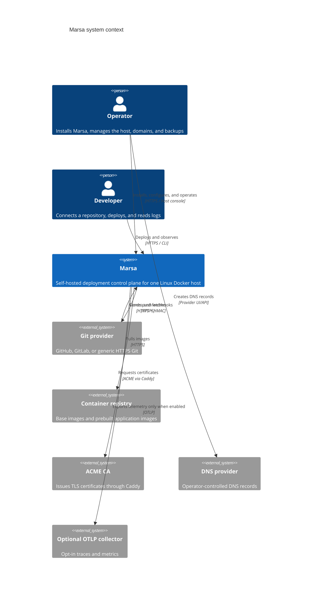
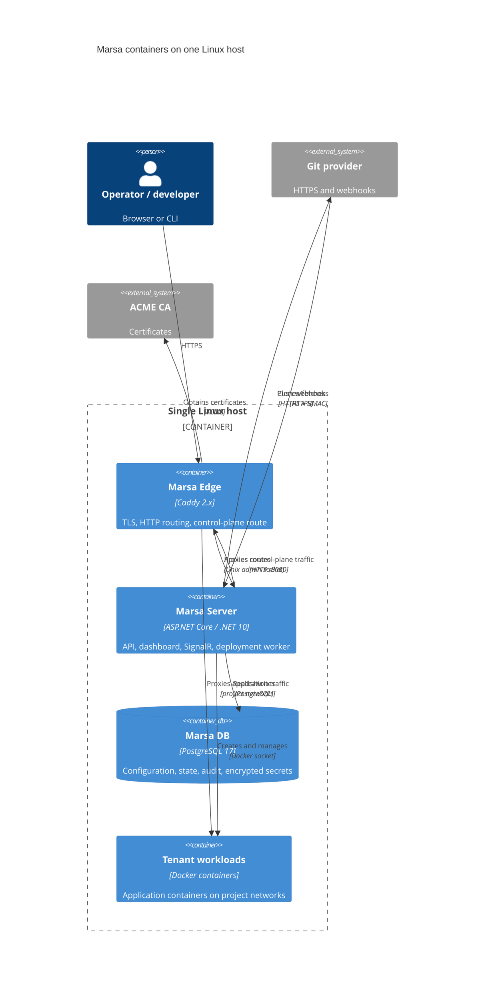
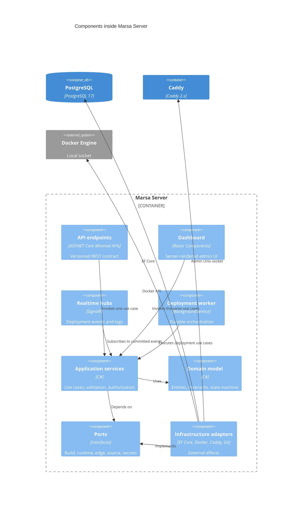
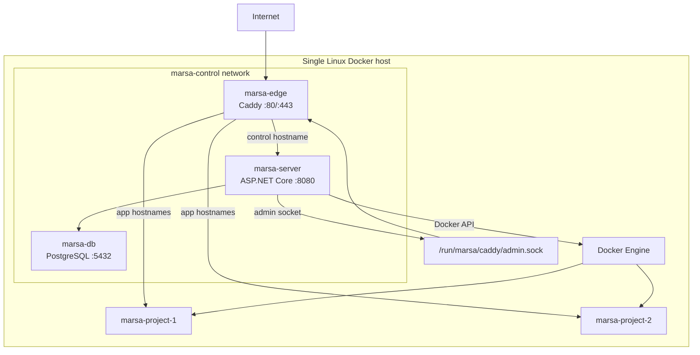
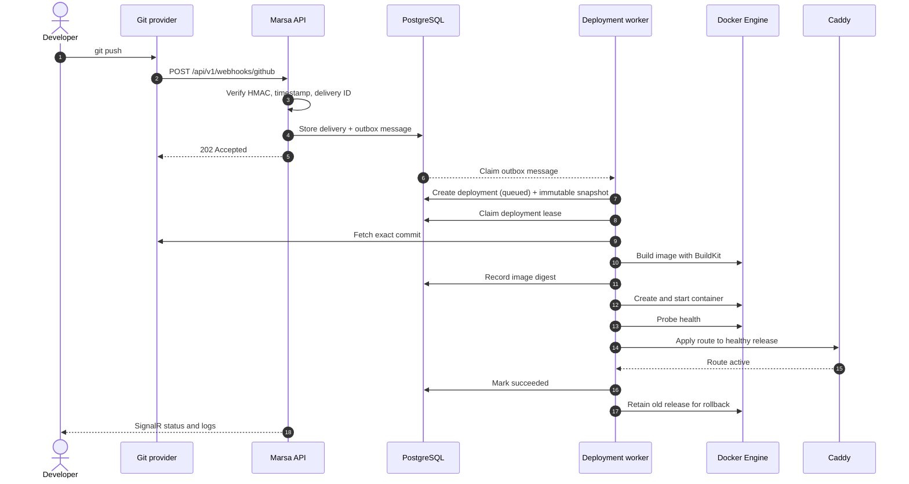
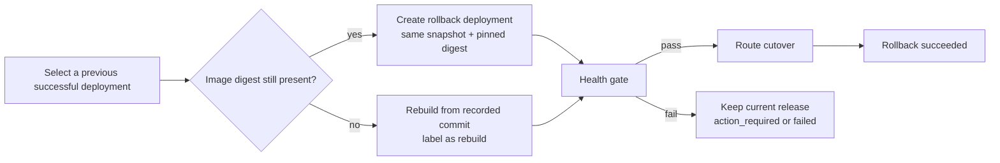
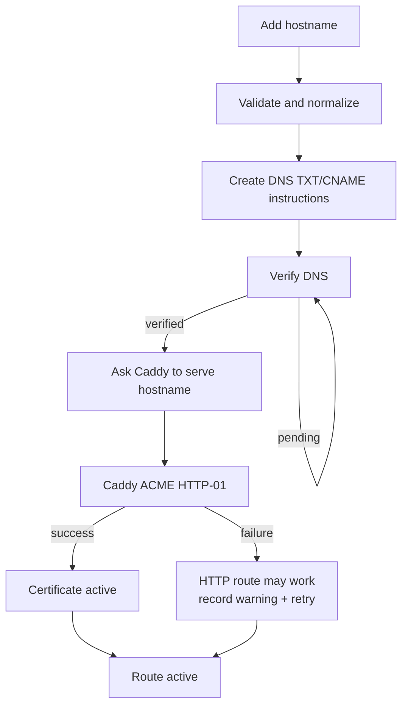

# Marsa — Architecture

> Status: Proposed for 0.1. Last reviewed: 2026-10-22.
> This document is the architectural baseline for implementation. Decisions that need an ADR are recorded in [`adr/`](../decisions/README.md). Security detail lives in [`../../architecture/security.md`](security.md); schema and API detail live in [`../../architecture/data-model.md`](data-model.md) and [`../../architecture/api.md`](api.md).

## 1. Architecture in one page

Marsa is a **modular monolith** packaged as one ASP.NET Core server process, one PostgreSQL database, and one Caddy edge on a single Linux Docker host.

- The **server** owns the API, server-rendered dashboard, SignalR hubs, and the deployment worker.
- **PostgreSQL** is the only required stateful dependency. It stores configuration, deployment state, encrypted secrets, audit events, and the durable work queue.
- **Caddy** is the public edge. It terminates TLS, routes the control-plane hostname, and routes application hostnames. Marsa controls it only through a Unix-domain admin socket.
- **Docker Engine** is the container runtime. Marsa talks to the local Docker socket and treats that access as root-equivalent host authority.
- Tenant workloads run on per-project Docker networks. They never receive the Docker socket, the Caddy admin socket, or host mounts.
- The dashboard and CLI are clients of the same `/api/v1` contract. Neither gets a private business-logic path.

The architecture optimizes for **one operator, one host, one clear deployment path**, not for horizontal scale.

## 2. Goals and non-goals

### 2.1 Goals

| Goal | Architectural consequence |
|---|---|
| Safe push-to-deploy | Durable deployment state machine, immutable snapshot, health gate before route change |
| Understandable failure | Persisted steps, redacted logs, stable error codes, visible state |
| Secure secret handling | Envelope encryption, write-only API, redaction, no plaintext in snapshots |
| Small operational surface | No Redis, broker, object store, Kubernetes, or external scheduler |
| Arabic-first UI | Server-rendered UI with per-user culture and RTL layout |
| .NET-native codebase | Clear project boundaries, standard ASP.NET Core, EF Core, and Identity |
| Recoverable operations | Reconciliation, leases, backups, explicit migrations |

### 2.2 Non-goals for 0.1

- Multi-host scheduling, SSH targets, Kubernetes, or Nomad.
- Compose import or multi-service orchestration.
- Managed databases, app catalog, or one-click services.
- GitHub App installation, pull-request previews, or check runs.
- MCP, AI mutation, chat-driven deploys, or autonomous operations.
- Desktop or mobile applications.
- Wildcard DNS/TLS, external CDN integration, or active-active HA.
- A public plugin marketplace or arbitrary assembly loading.

## 3. Invariants

These rules are not suggestions. Code review and tests must preserve them.

1. **Snapshot before execution.** Every deployment runs against an immutable snapshot. Editing a project cannot change an in-flight or historical deployment.
2. **One active deployment per environment.** A partial unique index and an environment row lock enforce it; the worker lease is a second line of defense.
3. **Health before route.** No release receives traffic until readiness and a stabilization window pass.
4. **The old release keeps serving until cutover succeeds.** A failed build, health check, or route apply must not remove the current release.
5. **Routing and TLS are separate outcomes.** A working route with a pending certificate is `succeeded_with_warnings`; a broken route is not success.
6. **Rollback is a new deployment.** History is never rewritten; a rollback pins a prior image digest and snapshot.
7. **Every mutation is attributable.** Audit records actor, source, resource, and before/after state without secret values.
8. **Durability beats process memory.** Cancellation, idempotency, leases, and progress survive restarts.
9. **The edge is not the control plane.** A control-plane crash must not stop already-routed applications.
10. **Docker access is privileged.** No user-controlled Docker parameter, host mount, or privileged container is allowed.
11. **No self-deployment.** Marsa refuses to deploy its own control-plane project onto itself.
12. **No silent telemetry.** Export is opt-in and off by default.

## 4. System context



### 4.1 Actors and external systems

| Actor/system | Responsibility | Trust |
|---|---|---|
| Operator | Installs, configures domains, backs up, upgrades | Authenticated admin |
| Developer | Connects sources, deploys, reads logs | Authenticated member |
| Git provider | Source of commits and signed push events | External, partially trusted |
| Container registry | Base and application images | External, pinned where possible |
| ACME CA | Certificate issuance | External |
| DNS provider | Hostname resolution | External, operator-controlled |
| OTLP collector | Optional telemetry sink | Disabled by default |

## 5. Containers



### 5.1 Container responsibilities

| Container | Technology | Responsibilities | Must not |
|---|---|---|---|
| Marsa Edge | Caddy 2.x, pinned by digest | TLS, ACME, HTTP routing, static control-plane route | Make authorization or deployment decisions |
| Marsa Server | .NET 10 ASP.NET Core | API, Razor dashboard, SignalR, worker, adapters | Serve tenant traffic directly |
| Marsa DB | PostgreSQL 17 | Durable state, audit, ciphertext, queue | Store plaintext secrets or private keys |
| Tenant workloads | Tenant images | Run application code | Access Docker, Caddy admin, host files, or other projects |

### 5.2 Runtime envelope

| Item | 0.1 target |
|---|---|
| Hosts | 1 |
| Control-plane replicas | 1 |
| Organizations per install | 1 |
| Projects | 100 |
| Services | 500 |
| Concurrent deployments | 4 |
| Concurrent dashboard users | 20 |
| Deployment log entries | 50,000 per deployment, chunked |
| Architecture | Linux `amd64` and `arm64` |

These are design assumptions, not benchmarks or SLAs.

## 6. Components inside Marsa Server



### 6.1 Component rules

- Endpoints and Razor Components are thin: bind input, authorize, invoke one application handler, map the result.
- Application services own transactions, use-case authorization, and workflow coordination.
- Domain types reference no EF Core, ASP.NET Core, Docker, Caddy, or Git.
- Ports are declared where they are used, normally in Application; Infrastructure implements them.
- The worker calls the same application services as the API and dashboard. It does not bypass validation or authorization.
- SignalR publishes after commit through the outbox. It is not the source of truth.
- The dashboard never reads `DbContext` directly.

## 7. Module boundaries

| Module | Owns | May depend on |
|---|---|---|
| Identity and Access | Users, sessions, PATs, roles | Tenancy, Audit |
| Tenancy | Organization, memberships, instance settings | None |
| Projects | Projects, source connections, environments, services | Tenancy, Identity, Audit |
| Sources and Detection | Git reads, repository snapshots, detection, `marsa.json` | Projects, Secrets |
| Deployments | Admission, snapshot, state machine, cancellation, rollback | Projects, Detection, Build, Runtime, Routing, Secrets, Servers, Audit |
| Build | Workspace, build execution, image digest, build logs | Sources, Secrets, Audit |
| Runtime | Container lifecycle, health, runtime logs | Servers, Secrets, Audit |
| Routing and Domains | Hostnames, verification, TLS status, Caddy desired state | Projects, Servers, Audit |
| Secrets | Env values, versions, encryption, masking | Tenancy, Projects, Audit |
| Servers | Local host capabilities; future SSH/helper boundary | Tenancy, Secrets, Audit |
| Webhooks | Signature verification, deliveries, branch filtering | Projects, Deployments, Audit |
| Audit and Observability | Append-only audit, events, metrics | None (write-only) |
| Platform | Health, version, settings, feature flags | Identity, Tenancy |

### 7.1 Dependency rule

```text
Contracts  <-  Application  ->  Domain
                    ^
                    |
              Infrastructure
                    ^
                    |
                 Server
```

- Domain references no other Marsa project.
- Contracts references no other Marsa project.
- Application references only Domain and Contracts.
- Infrastructure references Application, Domain, and Contracts.
- Server is the composition root and may reference Application, Infrastructure, and Contracts.
- CLI references Contracts and a generated HTTP client only.
- Cross-module side effects go through application services or narrow ports, never direct table writes.
- A new project requires an ADR and an update to [`../../architecture/solution-structure.md`](solution-structure.md).

## 8. Deployment topology



### 8.1 Networks and volumes

| Object | Purpose | Exposure |
|---|---|---|
| `marsa-control` | Server, database, edge | Internal Docker network |
| `marsa-project-<id>` | One project's workloads | Internal; edge attaches for routing |
| `marsa_data` | Server state and master-key material references | Server only |
| `marsa_edge` | Caddy admin socket | Server and edge only |
| `pgdata` | PostgreSQL data | Database only |
| `caddy_data` | Certificates and Caddy state | Edge only |
| `caddy_config` | Caddy configuration state | Edge only |

No workload publishes a host port. Caddy reaches workloads over project networks. The control-plane hostname is a **static** route so a broken dynamic route cannot lock the operator out.

### 8.2 Ports

| Component | Host port | Internal |
|---|---|---|
| Caddy | `80`, `443` | `2019` not exposed; admin over Unix socket |
| Server | None | `8080` |
| PostgreSQL | None | `5432` |
| Workloads | None | Declared application port |

## 9. Core workflow: push to live



### 9.1 Admission

1. The client sends `POST /api/v1/projects/{projectId}/deployments` with `Idempotency-Key`.
2. Marsa authorizes the actor and resolves the environment, service, branch, commit, and plan.
3. If the same commit and plan hash already produced a deployment, return that deployment unless `force=true`.
4. In one transaction, lock the environment row, verify no active deployment, insert the deployment and snapshot, and insert an outbox event.
5. Return `202 Accepted` with the deployment ID and links.

### 9.2 Build

- The source is materialized into a private workspace. `.git` is not part of the build context.
- BuildKit is used when available. The build receives only the snapshot's build arguments and secret references.
- Build secrets are mounted as BuildKit secrets, not passed as arguments or environment variables.
- Build output is an immutable image tagged by commit and content hash, with a recorded digest.
- Build logs are chunked, sequenced, redacted, persisted, and streamed.

### 9.3 Cutover

1. Create the new container on the project network with managed labels.
2. Start it and probe readiness.
3. Require a stabilization window with consecutive successful probes.
4. Apply the route through Caddy's Unix-socket admin API.
5. Mark `succeeded` or `succeeded_with_warnings`.
6. Keep the previous release until retention or explicit cleanup.

If routing fails and a previous release is serving, mark `action_required` and keep the old route. If there is no previous release, mark `failed`.

## 10. Deployment state machine

```mermaid
stateDiagram-v2
  [*] --> queued
  queued --> preparing: worker claims
  queued --> cancelled: cancel
  preparing --> building: snapshot valid
  preparing --> failed: validation/prepare error
  preparing --> cancelled: cancel
  building --> deploying: image digest recorded
  building --> failed: build error
  building --> cancelled: cancel
  deploying --> health_checking: container started
  deploying --> failed: start error
  deploying --> cancelled: cancel
  health_checking --> routing: healthy + stable
  health_checking --> action_required: unhealthy; previous serves
  health_checking --> failed: unhealthy; no previous
  health_checking --> cancelled: cancel
  routing --> succeeded: route active
  routing --> succeeded_with_warnings: route active; TLS pending
  routing --> action_required: route failed; previous serves
  routing --> failed: route failed; no previous
  succeeded --> [*]
  succeeded_with_warnings --> [*]
  action_required --> [*]
  failed --> [*]
  cancelled --> [*]
```



### 10.1 State rules

| Rule | Detail |
|---|---|
| No backward transitions | A deployment never returns to a previous phase. |
| Terminal states are immutable | `succeeded`, `succeeded_with_warnings`, `action_required`, `failed`, `cancelled`. |
| Cancellation | Accepted from `queued` through `health_checking`. `routing` is atomic and not cancellable. |
| Route failure | `action_required` when the old release still serves; `failed` when there is no old release. |
| TLS warning | `succeeded_with_warnings` when the route works but certificate issuance or renewal is pending. |
| Retry | A retry creates a new deployment or increments the attempt counter; it never rewinds state. |
| Rollback | Creates a new deployment with trigger `rollback`, pinned to the prior image digest and snapshot. |

## 11. Rollback and reconciliation

### 11.1 Rollback



Rollback is explicit. Marsa does not auto-rollback in 0.1. If the image was garbage-collected, the UI must say that the fallback is a rebuild, not a byte-for-byte rollback.

### 11.2 Reconciliation

- PostgreSQL is the desired state for routes, releases, and managed containers.
- On startup and periodically, the reconciler compares the database with Docker and Caddy.
- It repairs **only** resources carrying `io.marsa.managed=true` and matching labels.
- It never deletes unmanaged containers, images, networks, or Caddy routes.
- If repair is unsafe, it marks the server `degraded` and records a diagnostic rather than guessing.

## 12. Domains and TLS



- Hostnames are lowercase, IDNA-normalized, globally unique, and wildcard-free in 0.1.
- Verification uses an exact TXT record or CNAME, shown to the user.
- Caddy owns certificate private keys. Marsa stores status and expiry, not keys.
- Certificate issuance failure does not necessarily fail the deployment; it produces a warning if HTTP routing is correct.
- The route compiler emits the complete Marsa-managed route set, including the static control-plane route, and applies it transactionally.
- A Caddy restart is reconciled without manual database edits.
- The admin API is reachable only through `/run/marsa/caddy/admin.sock`; there is no TCP admin listener.

## 13. Security architecture summary

The full model is in [`../../architecture/security.md`](security.md).

| Boundary | Control |
|---|---|
| Browser to edge | TLS, secure cookies, CSP, HSTS, antiforgery |
| CLI to API | Bearer PAT, hashed at rest, scoped, expiring |
| Webhook to API | HMAC, constant-time compare, replay window, delivery dedupe |
| Server to Docker | Local Unix socket only; no TCP; no socket in workloads or builds |
| Server to Caddy | Unix admin socket, permissions `0660`, directory `0700` |
| Server to database | Internal network, strong credentials, encrypted backups |
| Secrets at rest | AES-256-GCM envelope encryption with a master key outside the database |
| Tenant isolation | Organization-scoped queries, resource authorization, cross-tenant tests |
| Build isolation | No host mounts, no Docker socket, CPU/memory/time limits, no privileged mode |
| Audit | Append-only, redacted, actor and resource recorded |

## 14. Reliability and operations

| Concern | Design |
|---|---|
| Worker crash | Durable lease, heartbeat, `FOR UPDATE SKIP LOCKED`, attempt limit, resume from persisted step |
| Server restart | Queued work and logs survive; in-flight steps are recovered or failed deterministically |
| Caddy restart | Desired routes are reconciled from PostgreSQL |
| Docker unavailable | Readiness degrades; deployments fail with `server.unavailable`; UI explains next action |
| Database unavailable | Readiness fails; no mutations are accepted |
| Disk pressure | Warning, degraded state, bounded logs/builds, managed cleanup |
| Backup | `pg_dump` plus master-key backup; restore drill before release |
| Upgrade | Expand/contract migrations; migration bundle; no automatic production migration |
| Telemetry | OpenTelemetry opt-in; logs and metrics work without a collector |

### 14.1 Health endpoints

| Endpoint | Checks | Used by |
|---|---|---|
| `/health/live` | Process is running | Container liveness |
| `/health/ready` | Database, schema, master key, Caddy socket | Edge/readiness |
| `/health/degraded` | Optional components and warnings | Dashboard/operator |

Liveness does not depend on Docker, Caddy, or optional telemetry.

## 15. Observability

- Structured JSON logs with request and trace IDs.
- OpenTelemetry traces for API requests, builds, Docker calls, and Caddy applies.
- Metrics: deployments by state, phase duration, queue age, build duration, lease expiry, route failures, certificate expiry, active managed containers.
- Deployment detail shows a phase timeline and links each phase to logs.
- Secret redaction is applied before persistence, not only at display.
- No telemetry leaves the host unless the operator explicitly configures an OTLP endpoint.

## 16. Technology choices

| Layer | Choice | ADR |
|---|---|---|
| Runtime | .NET 10 LTS, C# 14 | [0002](../decisions/0002-dotnet-10-lts.md) |
| Shape | Modular monolith, one deployable server | [0001](../decisions/0001-modular-monolith.md) |
| Database | PostgreSQL 17 via EF Core/Npgsql | [0003](../decisions/0003-postgresql-only-stateful-dependency.md) |
| Edge | Caddy 2.x | [0004](../decisions/0004-caddy-edge.md) |
| Containers | Docker Engine 27+ via local socket | [0005](../decisions/0005-docker-engine-socket.md) |
| Dashboard | Razor Components, server-rendered | [0006](../decisions/0006-razor-components.md) |
| Identity | ASP.NET Core Identity + PATs | [0007](../decisions/0007-local-identity-and-pats.md) |
| Work queue | PostgreSQL leases + outbox | [0008](../decisions/0008-postgresql-lease-worker-outbox.md) |
| Realtime | SignalR | [0009](../decisions/0009-signalr-realtime.md) |
| Topology | Single host | [0010](../decisions/0010-single-host-mvp.md) |
| State machine | Explicit canonical states | [0011](../decisions/0011-deployment-state-machine.md) |
| API | OpenAPI-first `/api/v1` | [0015](../decisions/0015-openapi-contract-first.md) |
| IDs | UUIDv7 | [0016](../decisions/0016-uuidv7-identifiers.md) |
| Secrets | Envelope encryption | [0017](../decisions/0017-envelope-encryption-master-key.md) |
| Desktop | Not in 0.1 | [0013](../decisions/0013-no-desktop-app-mvp.md) |
| Plugins | Deferred, internal ports only | [0014](../decisions/0014-plugin-model-deferred.md) |

## 17. Open questions

Decisions that would change this architecture are tracked in [`../../risks-and-open-questions.md`](../risks-and-open-questions.md). The highest-impact ones are:

- Is the Docker-socket trust model acceptable for the first public release, or must a socket proxy/host helper process ship first?
- Does 0.1 need runtime application-log browsing, or is deployment-log browsing plus `docker logs` enough?
- Should route application be a full-config replace or a per-route transaction within the Marsa-managed set?
- What is the minimum supported host size, and which resource limits become defaults?
