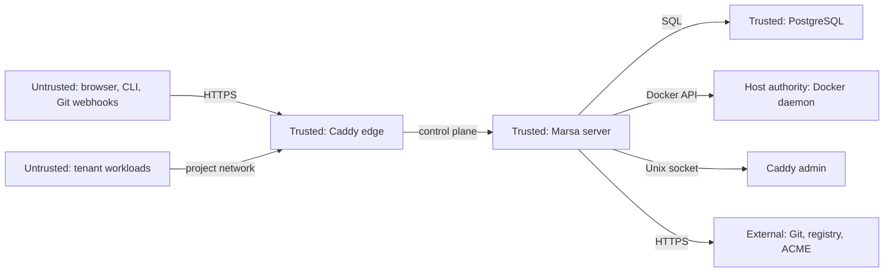

# Marsa — Security

> Status: Proposed for 0.1. Last reviewed: 2026-10-22.
> Security decisions that change scope or accepted risk are logged in [`../../risks-and-open-questions.md`](../risks-and-open-questions.md). This document is the implementation checklist.

## 1. Security posture

Marsa is a **privileged control plane** for a single-operator Docker host. Compromise of the server is close to compromise of the host, because the server can control the Docker daemon. The security model is therefore explicit, conservative, and documented rather than implied.

Core rules:

1. Docker socket access is root-equivalent. Treat it as a privileged capability, not a normal dependency.
2. Workloads and builds never receive the Docker socket, the Caddy admin socket, or host mounts.
3. Every tenant-owned query is organization-scoped.
4. Secrets are encrypted at rest, write-only through the API, and redacted before persistence or export.
5. Route and TLS administration is local-only over a permissioned Unix socket.
6. No default credentials, no silent telemetry, no automatic production migration.
7. When a control is impossible in 0.1, document it as residual risk and add a trigger for revisiting it.

## 2. Trust boundaries

| Zone | Assets | Crossing | Controls |
|---|---|---|---|
| Untrusted clients | Browser, CLI, webhook payloads | HTTPS/API | TLS, auth, CSRF, HMAC, rate limits, validation |
| Trusted control plane | Server, DB, edge | Internal networks and sockets | Resource authorization, encryption, redaction, socket permissions |
| Host authority | Docker daemon, host filesystem | Server to Docker | No arbitrary Docker parameters, label guard, no host mounts, no TCP socket |
| Tenant workloads | Application data and traffic | Project networks | Per-project isolation, no control-plane networks, no host authority |
| External services | Git, registries, ACME, DNS | Outbound HTTPS, signed inbound | URL allowlists, SSRF checks, signature verification |

### 2.1 Docker boundary

The server needs the Docker API to build, create, start, stop, and inspect containers. That access can:

- start a privileged container,
- mount the host filesystem,
- join the host network,
- read other containers' secrets,
- and effectively become root on the host.

Mitigations in 0.1:

- The Docker endpoint is a local Unix socket, never TCP.
- The server never accepts a raw Docker operation from a user. It accepts a constrained deployment plan.
- Image references, commands, mounts, capabilities, and network modes are validated against an allowlist.
- Workloads are created with `io.marsa.managed=true`, organization, project, service, and deployment labels.
- The runtime refuses to mutate containers without the managed label and matching organization.
- Privileged mode, host networking, host PID/IPC, devices, and host bind mounts are rejected.
- Builds run without the Docker socket and without host mounts.
- The server runs as non-root and joins only the `docker` group or uses rootless Docker when available.
- A socket proxy or host helper process is a post-MVP hardening option; it is not a complete security boundary.

**Residual risk:** a vulnerability in the server, a malicious image, or a kernel/container escape can compromise the host. The operator must treat the host as dedicated to Marsa and keep it patched.

## 3. Authentication

### 3.1 Setup

- First run generates a one-time setup token (256 bits of entropy) and stores only a SHA-256 hash in PostgreSQL.
- The plaintext token is delivered exclusively to a restricted file in the runtime directory (`/var/lib/marsa/setup-token` with mode `0600`). It is NEVER printed to container logs (stdout/stderr) or application log files to prevent exposure in shared log sinks or monitoring pipelines.
- Setup is rate-limited (5 attempts/minute per client IP) using client IP forwarding validated strictly against configured trusted reverse proxies (Caddy); untrusted callers cannot bypass rate limiting via spoofed `X-Forwarded-For` headers.
- The setup token is single-use, compared in constant time, and expires after 24 hours.
- If the token expires before use, or if the operator loses the token file before setup completes, restarting the service with `MARSA_REGENERATE_SETUP_TOKEN=true` (or restarting after expiry) invalidates previous tokens and issues a fresh one without locking out the host operator.
- Once the first administrator is created, the setup token file is deleted and all setup endpoints return `404 Not Found` to conceal instance state.
- There is no default password and no unauthenticated "first user wins" path. Concurrent initial setup attempts are bounded to at most one administrator by a database-level singleton constraint.

### 3.2 Dashboard sessions

- ASP.NET Core Identity with a modern password hash.
- Cookie flags: `HttpOnly`, `Secure` in production, `SameSite=Lax`.
- Session rotation on login and privilege change.
- Logout invalidates the server-side session.
- Cookie-authenticated unsafe methods require antiforgery protection and an origin check.
- Security headers: CSP, HSTS in production, frame denial, `X-Content-Type-Options: nosniff`, and a strict referrer policy.
- No loopback zero-auth mode in the container deployment.

### 3.3 Personal access tokens

- Format: `marsa_pat_<base64url-random-32-bytes>`.
- Stored as SHA-256 hashes; the plaintext is returned once.
- Prefix indexed for lookup without storing the secret.
- Scopes: `read`, `deploy`, `admin`; never broader than the creating user's role.
- Optional expiry, maximum one year.
- Revoked automatically when the user loses organization membership.
- Never accepted as a positional CLI argument.
- `last_used_at` updated at most once per minute.

### 3.4 Future identity

OIDC/SSO is out of scope for 0.1. When added, use a reviewed provider or OpenIddict; do not build a custom OAuth server. External identities must map to a membership, not bypass it.

## 4. Authorization

### 4.1 Roles

| Capability | Owner | Admin | Developer | Viewer |
|---|---|---|---|---|
| Organization settings | yes | yes | no | no |
| Members and roles | yes | yes | no | no |
| Servers | yes | yes | no | read |
| Projects | yes | yes | create/read/update | read |
| Sources | yes | yes | connect/read | read |
| Deploy/rollback/cancel | yes | yes | yes | no |
| Env and secrets | yes | yes | read/write values | read metadata |
| Domains and certificates | yes | yes | yes | read |
| Audit | yes | yes | own actions | no |
| API tokens | own | own + others | own | own |

### 4.2 Enforcement

- Endpoint policies check the required permission.
- Application handlers re-check resource ownership and role.
- EF Core global query filters are a backstop, not the primary control.
- Child resources resolve their owning organization through the parent chain.
- Cross-tenant probes return no existence signal: `404` rather than `403` when revealing existence would leak data.
- The last owner cannot be removed or demoted.
- Every denied request is audited with actor, action, resource, and reason; no secret values.

### 4.3 PAT scopes

- `read`: GET endpoints and log reads.
- `deploy`: `read` plus deploy, cancel, rollback, env writes, and domain verification.
- `admin`: `deploy` plus project, member, server, and token administration.
- A token cannot create a token with broader scopes.
- Admin-only secret reveal is not granted by `admin` alone; it also requires the feature flag and an owner/admin session.

## 5. Secrets

### 5.1 Encryption

- AES-256-GCM envelope encryption.
- Format: versioned envelope containing key version, nonce, ciphertext, and tag.
- Master key from a root-owned file or environment variable, never from the database or image.
- Key version recorded on every ciphertext.
- Rotation creates a new key version and re-encrypts lazily; old versions remain until no deployment references them.
- Missing master key fails startup closed for secret-dependent operations.
- Database backups are useless without the master key; the key must be backed up separately.

### 5.2 API behavior

- Secret values are write-only.
- List and detail responses return metadata, version, and masked hints only.
- Secret versions are immutable.
- Deployment snapshots carry secret IDs and versions, never plaintext.
- Plaintext is decrypted only at container creation or a BuildKit secret mount.
- Environment values are not included in error messages, logs, events, audit, metrics, or traces.
- The optional reveal endpoint is admin-only, feature-flagged, disabled by default in production, and audited.

### 5.3 Redaction

- Central redaction service with known secret values and token patterns.
- Applied before persistence, before SignalR broadcast, and before OTLP export.
- Canary tests inject unique secret-looking values and assert absence from logs, events, audit, errors, and telemetry.
- Build logs are redacted before being stored, not only when displayed.
- Redaction is defense in depth, not permission to log secrets.

### 5.4 Master-key recovery

- The install output explains that the master key is required to restore secrets.
- The backup runbook backs up the key separately from the database.
- A restore test without the key must fail closed with a clear diagnostic.
- Key rotation is documented and audited.

## 6. Input validation and SSRF

All user-controlled input is untrusted.

| Input | Validation |
|---|---|
| Hostname | Lowercase, IDNA-normalized FQDN; no wildcard, IP literal, port, path, or trailing dot; global uniqueness |
| Path prefix | Starts with `/`; no `..`, encoded separators, query, fragment, or control characters |
| Repository URL | Absolute HTTPS; no credentials, `file://`, `ssh://`, loopback, link-local, or private address unless explicitly allowed |
| Branch | Valid Git ref; no control characters; bounded length |
| Commit | Full 40 or 64 hex characters |
| Env key | `^[A-Z_][A-Z0-9_]*$`, max 128 |
| Image reference | Parsed; registry allowlist; no digest ambiguity; no unmanaged host paths |
| Build context | Relative path under the repository root; no symlink escape |
| Webhook body | Bounded size; raw-body signature verification before JSON parsing |
| Health path | Starts with `/`; no control characters; bounded length |
| Docker labels | Reserved prefix `io.marsa.*`; users cannot set or spoof managed labels |

SSRF rules:

- Do not fetch arbitrary URLs supplied by users.
- Git and registry connections use validated HTTPS endpoints.
- DNS is resolved and re-checked before outbound provider calls; private, loopback, link-local, and metadata addresses are blocked.
- Redirects must stay on the allowed host and scheme.
- No user-controlled webhook callbacks in 0.1.
- No arbitrary health-check host; health checks target the workload port only.

## 7. Build and runtime isolation

### 7.1 Builds

- Build context is materialized from the exact commit into a private workspace.
- `.git` is excluded from the context.
- Symlinks that escape the context are rejected.
- Archive size, file count, and decompression ratio are bounded.
- Builds run with CPU, memory, and time limits.
- Builds do not receive the Docker socket or host mounts.
- Build secrets use BuildKit secret mounts, not arguments or environment variables.
- Untrusted Dockerfiles are code execution; the UI and docs state this plainly.
- Build cache is scoped and pruned on a schedule.

### 7.2 Runtime containers

- No privileged mode.
- No host network, PID, IPC, or devices.
- No host bind mounts.
- Read-only root filesystem where the image supports it.
- Non-root user where the image supports it.
- Dropped Linux capabilities; `no-new-privileges`.
- CPU, memory, and PID limits.
- One project network per project.
- Caddy is the only component attached to multiple project networks.
- Workloads cannot reach `marsa-control` or the Caddy admin socket.

### 7.3 Caddy

- Admin API on a Unix socket only: `/run/marsa/caddy/admin.sock`.
- Directory mode `0700`, socket mode `0660`, shared only by the server and edge.
- No TCP admin listener.
- Caddy has no Docker socket.
- The control-plane route is static and always present.
- Route changes are serialized and validated.

## 8. Webhooks

- Verify HMAC-SHA256 over the raw body before parsing.
- Constant-time comparison.
- Replay window and maximum body size.
- Unique `(provider, delivery_id)` as the idempotency boundary.
- Branch filter and event filter.
- Per-source secret, encrypted at rest.
- Provider IP allowlists are optional and not a substitute for signatures.
- Return `202` quickly; process slow work through the outbox.
- Never trust `X-Forwarded-*` unless the immediate peer is the trusted edge.
- GitHub App installation binding is post-MVP; the MVP uses a per-source secret.

## 9. Network and transport

- Caddy terminates public TLS.
- HSTS in production after HTTPS is confirmed.
- HTTP redirects to HTTPS for verified hostnames, except ACME challenges.
- No external reverse proxy in front of Caddy in the supported topology; if the operator adds one, trusted-proxy configuration is explicit.
- Internal service-to-service traffic stays on Docker networks.
- PostgreSQL is not published to the host.
- The server port is not published; only Caddy is exposed.
- Outbound HTTPS is allowed for Git, registries, and ACME; egress allowlisting is a hardening option.

## 10. Audit

Audit events are append-only and cover:

- setup, login, logout, failed login,
- token creation, rotation, revocation,
- project and source changes,
- deployment create, cancel, rollback, failure,
- secret create, rotate, reveal,
- domain add, verify, remove, certificate retry,
- member and role changes,
- server configuration and diagnostics,
- denied authorization attempts.

Each event records actor type and ID, action, target, timestamp, IP, user agent, request ID, and redacted metadata. Before/after values may be recorded only for non-secret fields. Audit failure does not roll back a successful deployment, but it is logged and surfaced as degraded.

## 11. Rate limits and resource bounds

| Scope | Limit |
|---|---|
| Login | 10 attempts/minute per IP + account |
| Setup | 5 attempts/minute per IP |
| PAT API | 600 requests/minute per token |
| Deployment creation | 10/minute per project |
| Webhook ingestion | 120/minute per source |
| Log streaming | 10 concurrent streams per organization |
| Build concurrency | 4 per host, configurable |
| Request body | 1 MiB default; webhook 1 MiB; larger uploads rejected |
| Log chunk | 16 KiB |
| Repository | Configurable size/file-count limit before clone/build |

`429` responses include `Retry-After`. Limits are configurable and never disabled silently.

## 12. Supply chain

- Pin SDK, NuGet packages, base images, Caddy, and PostgreSQL by version; release images by digest.
- Commit lockfiles.
- Restore in locked mode in CI.
- Generate an SBOM for source and images.
- Run dependency and image vulnerability scans.
- Block unapproved High/Critical findings.
- No GPL, AGPL, SSPL, BUSL, Commons Clause, or unknown-license dependency in the default distribution.
- No `git` CLI in the runtime image; if a builder image includes it, comply with GPL obligations or use a permissive source fetcher.
- Review new dependencies for maintenance, license, and necessity.
- Record accepted exceptions with owner, expiry, and compensating control.

## 13. Security headers

| Header | Value |
|---|---|
| `Content-Security-Policy` | Default self; no inline script except generated nonces; no third-party scripts |
| `Strict-Transport-Security` | `max-age=31536000; includeSubDomains` in production |
| `X-Content-Type-Options` | `nosniff` |
| `X-Frame-Options` / `frame-ancestors` | Deny |
| `Referrer-Policy` | `strict-origin-when-cross-origin` |
| `Permissions-Policy` | Disable camera, microphone, geolocation, and sensors |
| `Cache-Control` | `no-store` for authenticated HTML and API responses containing metadata |

## 14. Security testing

Required before release:

- Authorization matrix for every endpoint: anonymous, viewer, developer, admin, owner, cross-tenant, revoked token.
- CSRF and session tests.
- Secret-canary tests across logs, events, audit, errors, and telemetry.
- Path traversal, symlink escape, archive bomb, and oversized repository tests.
- SSRF tests for repository URLs and redirects.
- Webhook signature, replay, dedupe, and branch-filter tests.
- Docker label guard and unmanaged-container refusal tests.
- Caddy socket permission and no-TCP-admin tests.
- Rate-limit and body-size tests.
- Dependency, image, and secret scans.

## 15. Residual risks

| Risk | Why it remains | Mitigation / trigger |
|---|---|---|
| Docker socket is root-equivalent | The server needs Docker to deploy | Dedicated host, no untrusted users, label guard, consider socket proxy/helper process before public release |
| Malicious Dockerfile can execute code in the builder | Builds are code execution | No socket/host mounts, limits, dedicated network, clear warning |
| Kernel/container escape | Docker is not a perfect sandbox | Patch host, no privileged containers, least privilege |
| Same analyst read Openship | Not a formal double-blind clean room | Behavioral facts only, independent design, evidence ledger, legal review |
| Master key loss | No KMS in 0.1 | Separate backup, restore drill, clear documentation |
| Single host has no HA | Scope decision | Document limits; no HA claims; backup/restore |
| No external reverse proxy support | Keeps trust model simple | Document Caddy as the edge; explicit proxy config is post-MVP |
| OIDC/SSO absent | Scope decision | Strong local passwords, PAT scopes, rate limits |

## 16. Release security checklist

- [ ] No default credentials or unauthenticated setup path.
- [ ] Setup token is one-time, hashed, rate-limited, audited.
- [ ] Cookie flags, antiforgery, and security headers correct in production.
- [ ] PATs hashed, scoped, expiring, revocable, and never logged.
- [ ] Cross-tenant tests pass for every endpoint.
- [ ] Secret canaries absent from logs, events, audit, errors, and telemetry.
- [ ] Master key required and backed up separately.
- [ ] Docker socket not exposed over TCP, not in workloads, not in builds.
- [ ] Caddy admin socket only, permissions correct, no TCP admin.
- [ ] Webhooks verify raw-body HMAC, replay, and dedupe.
- [ ] SSRF, path traversal, symlink, and archive limits tested.
- [ ] Rate limits active.
- [ ] SBOM, license inventory, and vulnerability scan reviewed.
- [ ] Runbooks cover Docker down, Caddy down, DB down, disk full, lost key, and worker crash.
- [ ] Residual risks reviewed and accepted in writing.
